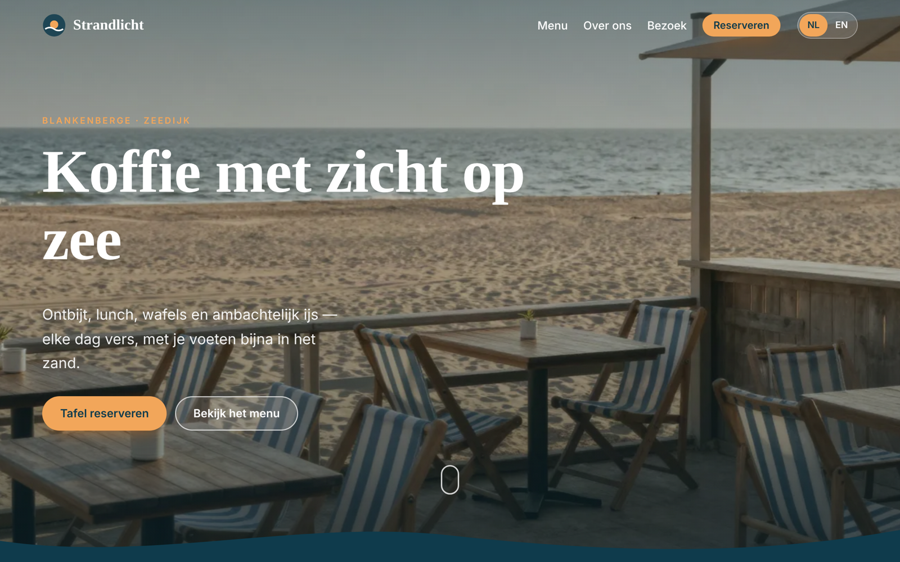

# Café Strandlicht — bilingual café website (NL / EN)

A fast, mobile-friendly one-page website for a small beach café in Blankenberge, Belgium.
**Demo project:** Café Strandlicht is a fictional business. All photos are AI-generated.

**Live demo:** https://suryavansivsingh.github.io/cafe-strandlicht/



## Who it's for
Small local businesses — cafés, restaurants, shops, B&Bs — that need a simple, good-looking website in Dutch and English without a monthly website-builder subscription.

## Features
- **Dutch + English** with one click. The choice is kept in the link (`?lang=en`) so you can share the English version.
- **Menu with tabs** (coffee, breakfast, lunch, waffles & ice cream), prices in €. Edit one file to change dishes or prices.
- **Scroll animations:** fade-in sections, parallax photos, count-up numbers, scrolling text band, reading-progress bar. They switch off automatically for visitors who prefer less motion.
- **Opening hours** with today highlighted and a live "Open now / Closed now" badge (Belgian time).
- **Map** (OpenStreetMap — no API key, no cost).
- **Reservation form** with checks for name, email, date and group size. It sends to your inbox via [Web3Forms](https://web3forms.com) (free) or runs in demo mode.
- Keyboard and screen-reader friendly. Lighthouse (mobile): Performance 98 · Accessibility 100 · Best Practices 96 · SEO 100.

## Quick start
No build step. Plain HTML, CSS and JavaScript.

```bash
# view it locally
npx serve .            # then open http://localhost:3000
```

**Receive real form emails:** create a free access key at web3forms.com and paste it into `js/config.js`:
```js
window.SITE_CONFIG = { WEB3FORMS_ACCESS_KEY: "your-access-key" };
```
Empty key = demo mode (the form shows a thank-you message but sends nothing).

**Change text, dishes or prices:** edit `js/i18n.js`. Every text exists once in Dutch and once in English.

## Tests
```bash
npm install
npx playwright install chromium
npm test           # 13 browser tests: language switch, menu tabs, scroll animations, form checks, mobile layout, images, JS errors
npm run validate   # HTML validation
```
A manual checklist for phones and tablets is in [`tests/manual-checklist.md`](tests/manual-checklist.md).

## Project structure
```
index.html          page structure
css/style.css       design, animations, mobile layout
js/i18n.js          all text (NL + EN) and the menu
js/main.js          language switch, tabs, scroll animations, open-now badge, form
js/config.js        form setting (Web3Forms access key)
assets/img/         photos (WebP)
tests/              automated tests + manual checklist
```

## Limitations
- One page only. No online ordering or payments.
- Menu and prices are edited in code (`js/i18n.js`), not in an admin panel.
- The free Web3Forms plan has a monthly limit on form submissions.
- Address and phone number are placeholders.

## License
MIT. Photos are AI-generated for this demo.
